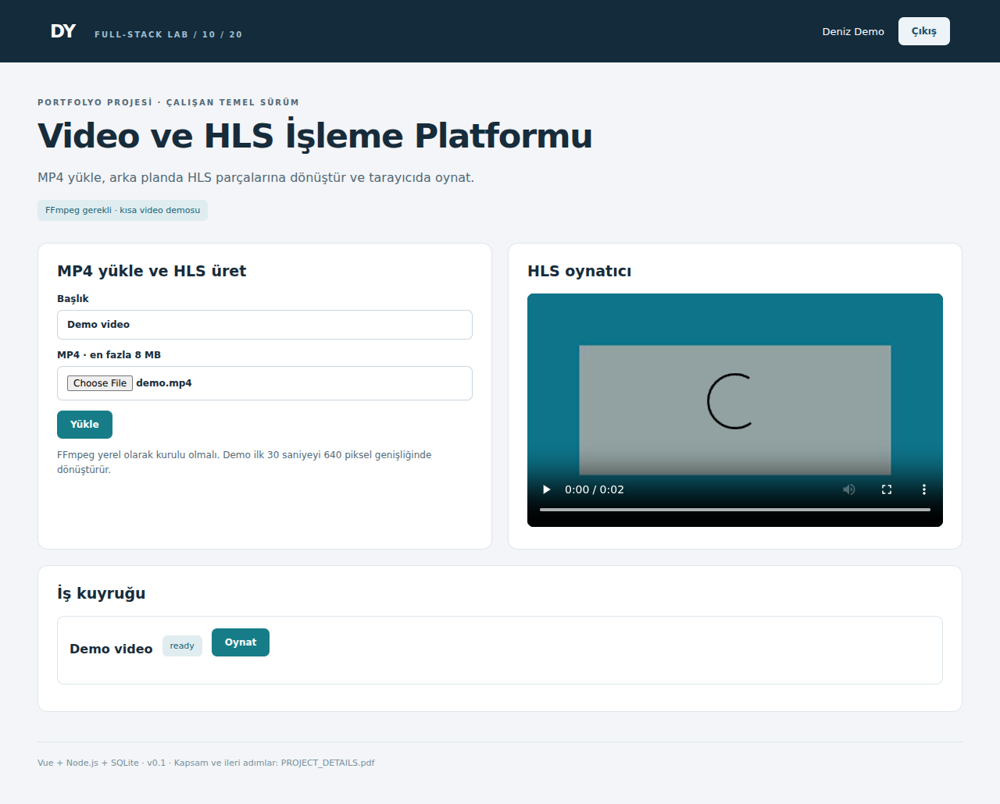

# Video ve HLS İşleme Platformu

MP4 yükle, arka planda HLS parçalarına dönüştür ve tarayıcıda oynat.



**Durum:** Çalıştırılabilir yerel temel sürüm (v0.1). FFmpeg gerekli · kısa video demosu.

## Kurulum

Node.js 24.x ve npm gerekir. İlk kurulumda npm paketlerini indirmek için internet bağlantısı gerekir. Node 24 `node:sqlite` deneysel uyarısı yazabilir; bu uyarı tek başına hata değildir.

```bash
npm ci
npm run dev
```

Tarayıcı: http://localhost:3000. Giriş: **demo@example.com / Demo12345!**. İkinci hesap: **other@example.com / Demo12345!**.

İkinci terminalde, aynı proje klasöründe:

```bash
npm run seed
```

Seed komutu örnek kayıt ekler; tekrar çalıştırmak yeni örnek kayıtlar oluşturabilir. Bazı projelerde başlangıç kataloğu zaten hazırdır; seed bunu açıklar.

## Derleme ve test

```bash
npm test
npm run typecheck
npm run build
npm start
```

`npm run dev` sırasında değişiklikleri Vite işler. `npm start` için önce build gerekir. Testler RAM veritabanı ve rastgele portla çalışır; kendi verilerini oluşturur. Mevcut demo veritabanını değiştirmez. Typecheck TypeScript giriş/ortak bileşenlerini ve Vue şablonlarını kapsar; JavaScript backend'in tam tip doğrulaması değildir.

## Çalışan özellikler

- 8 MB MP4 yükleme
- Kalıcı işlem durumu
- Tek worker kuyruğu
- FFmpeg ile HLS
- hls.js oynatıcı

## Kapsam sınırı

FFmpeg makinede kurulu olmalı. İlk 30 saniye, 640 piksel, tek kalite profili. Dockerfile FFmpeg içermez. Gerçek streaming CDN, adaptif kalite merdiveni ve BullMQ yok. Dosya HTTP JSON base64 ile yüklenir.

FFmpeg komutunun PATH içinde bulunması gerekir: `ffmpeg -version`. Alternatif olarak FFMPEG_PATH ortam değişkenine tam çalıştırılabilir dosya yolunu ver. fixtures/demo.mp4 iki saniyelik sentetik videodur. Bu sürüm için Dockerfile kullanacaksan FFmpeg kurulumu eklemelisin.

## Dosyalar ve akış

| Dosya | Sorumluluk |
| --- | --- |
| client/Workspace.vue | Projeye özel formlar, listeler, kullanıcı eylemleri |
| client/App.vue | Oturum açma ve ortak sayfa düzeni |
| client/api.ts | Fetch, hata mesajı, para/tarih yardımcıları |
| server/project.js | Alan kuralları, SQL sorguları ve API uçları |
| server/core.js | Veritabanı, doğrulama, oturum ve SSE yardımcıları |
| server/index.js | Express başlatma, güvenlik başlıkları ve statik dosyalar |
| schema.sql | Uygulamanın gerçek tablo/indeks şeması; referans amaçlı |
| tests/project.test.js | Gerçek HTTP istekleriyle kritik iş kuralları |
| scripts/seed.js | Örnek veri ekleme |
| PROJECT_DETAILS.pdf | Beş sayfalık proje açıklaması, API, test ve geliştirme rehberi |

Arayüz → aynı origin `/api` → oturum/sahiplik/doğrulama → iş kuralı → SQLite → JSON → görünüm. SQLite `data/app.sqlite` dosyasında kalıcıdır. Bu küçük uygulamalarda tablolar açılışta `CREATE TABLE IF NOT EXISTS` ile kurulur; sürümlü migration sistemi henüz yoktur.

## İş kuralı

ftyp MP4 başlığı ve boyut kontrol edilir. FFmpeg shell kullanılmadan argüman dizisiyle başlatılır. Dosya protokolleri sınırlandırılır, işlem 60 saniyede kesilir. Kullanıcı yalnız kendi video parçalarını okuyabilir; parça adları izinli desenle eşleşmelidir. Yeniden başlatmada yarım kalan işler hata olarak işaretlenir.

## API haritası

Oturum: `POST /api/auth/login` JSON `{"email":"demo@example.com","password":"Demo12345!"}`; `GET /api/auth/me`; `POST /api/auth/logout`. Çerez HttpOnly + SameSite=Strict. Tarayıcı aynı origin kullanır.

| Yöntem ve yol | Girdi | Başarı |
| --- | --- | --- |
| GET /api/videos | Gövde yok | 200 |
| POST /api/videos | JSON: title, base64 | 202 |
| GET /api/videos/:id/file/:name | Gövde yok | 200 |

Uç nokta gövdelerinin somut örnekleri `tests/project.test.js` ve `scripts/seed.js` içinde bulunur. `:id` alanlarını önceki oluşturma yanıtından al. Hatalar JSON `{"error":"açıklama"}` biçimindedir; 401 giriş, 403 rol/origin, 404 kayıt/sahiplik, 409 çakışma, 422 doğrulama, 429 kota anlamına gelir. Listeler küçük yerel demo kapsamındadır; tümünde sayfalama yoktur.

```text
POST /api/videos
{"title":"Demo","base64":"<mp4-base64>"}
202 {"id":"<video-id>"}
```

## Kabul senaryoları

- [ ] MP4 olmayan dosya 422 ile reddedilmeli.
- [ ] FFmpeg varsa örnek MP4 HLS ready durumuna gelmeli.
- [ ] HLS manifesti ve parçalar yalnız sahibine sunulmalı.
- [ ] Video HLS oynatıcıda yüklenebilmeli.

## İlk gün yapacağın çalışma

fixtures/demo.mp4 dosyasını yükle. queued/processing/ready akışını izle; HLS manifest ve .ts isteklerini tarayıcıda incele.

## Sonraki geliştirmeler

- [ ] Multipart upload ekle
- [ ] Kalıcı kuyruk ve ayrı worker kullan
- [ ] Çoklu kalite profili üret
- [ ] Obje deposu, süreli URL ve CDN ekle

## GitHub sunumu

Önce kurulumu çalıştır, testleri oku ve en az bir davranışı kendin geliştir. Her gün yaptığın gerçek değişikliği açıklayan commit at. `feat: ...`, `fix: ...`, `test: ...`, `docs: ...` örnek öneklerdir. `docs/screenshot.png` başlangıç sürümünün ekranıdır; değişikliklerinden sonra kendi ekranınla güncelle.

`.gitignore`, node_modules, dist, data ve .env dosyalarını dışarıda bırakır. Veritabanını, anahtarları veya gerçek müşteri/aday belgelerini GitHub'a koyma. GitHub repo oluşturma/yükleme bu paket tarafından otomatik yapılmaz.

## Ortam ayarları

`.env.example` dosyasını `.env` olarak kopyala; dosya varsayılan npm komutlarında otomatik okunmaz. Kullanmak için `node --env-file=.env server/index.js --dev`. PORT varsayılan 3000, HOST 127.0.0.1, DB_PATH data/app.sqlite. DEMO_PASSWORD yalnız yeni veritabanında hesap oluşturulurken kullanılır; var olan parolayı değiştirmez. COOKIE_SECURE yalnız HTTPS ortamında 1 olmalı. Farklı projeleri aynı anda çalıştırırken farklı PORT kullan.

## Dağıtım notu

Bu sürüm yerel portfolyo/öğrenme içindir. Genel internete açmadan önce demo hesaplarını kaldırıp kayıt/parola sıfırlama ve gerçek kullanıcı yaşam döngüsü ekle. Tek süreç/senkron SQLite yaklaşımı yoğun trafikli hizmet için hedef mimari değildir. PostgreSQL geçişinde SQL tipleri, transaction sınırları, indeksler, migration ve yedeklemeyi ayrıca tasarla. Dockerfile genel Node uygulaması içindir; Docker runner ve FFmpeg gibi özel bağımlılıklar otomatik kurulmaz.

## Mülakat provası

Video dönüşümü neden HTTP isteğini bekletmemeli? Adaptive bitrate için kaç manifest türü gerekir?

## Lisans

MIT; bağımlılıkların kendi lisansları saklıdır.


## Teknik referanslar

Ayrıntılı resmî kaynaklar ana başlangıç rehberinde listelenmiştir.
